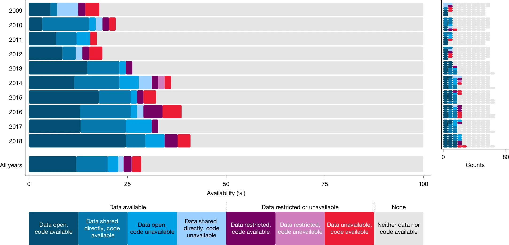
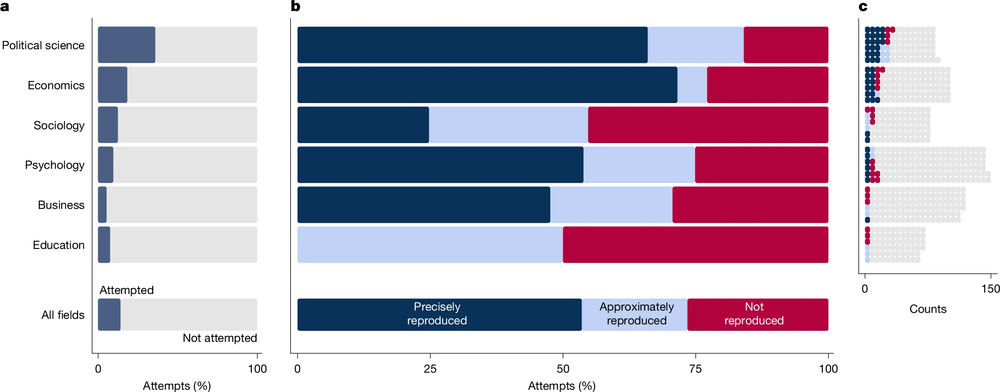
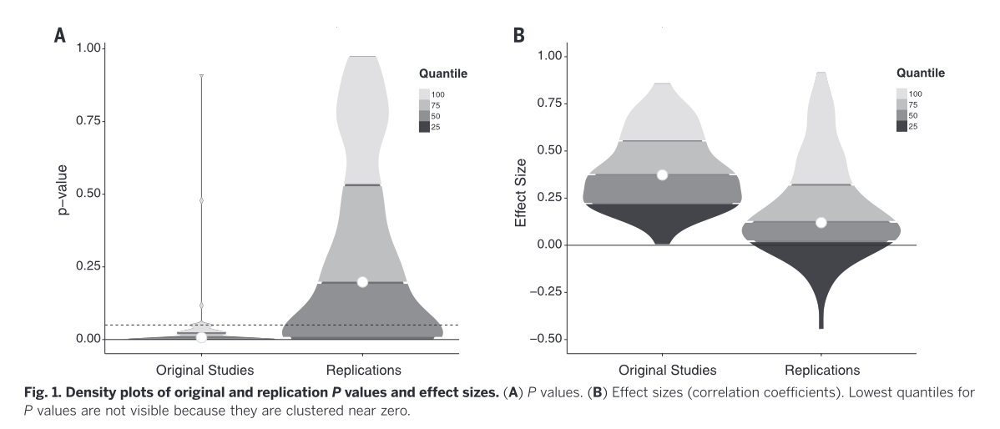

## Attendance

## Built-in control {background-color="var(--dark-purple)"}

   

::: {style="text-align: right;"}
**"But scientific power is like inherited wealth: attained without discipline. You read what others have done, and you take the next step. \[...\] There is no discipline lasting many decades. \[...\] There is no humility before nature."**
:::

## 

::: {layout-ncol="2" style="text-align:center;"}
{fig-align="center" width="400"}

{fig-align="center" width="400"}
:::

##  {.center background-image="../img/unsplash/ux-indonesia-qC2n6RQU4Vw-unsplash.jpg"}

::: r-fit-text
[**RESEARCH**]{.shadow-text style="color: var(--medium-purple)"}
:::

::: aside
[Photo by <a href="https://unsplash.com/@uxindo?utm_source=unsplash&utm_medium=referral&utm_content=creditCopyText">UX Indonesia</a> on <a href="https://unsplash.com/photos/person-writing-on-white-paper-qC2n6RQU4Vw?utm_source=unsplash&utm_medium=referral&utm_content=creditCopyText">Unsplash</a>]{style="font-size: 8px;"}
:::

##  {background-image="../img/unsplash/alex-shute-bGOemOApXo4-unsplash.jpg"}

::: aside
[Photo by <a href="https://unsplash.com/@faithgiant?utm_source=unsplash&utm_medium=referral&utm_content=creditCopyText">Alex Shute</a> on <a href="https://unsplash.com/photos/a-wooden-block-that-says-trust-surrounded-by-blue-flowers-bGOemOApXo4?utm_source=unsplash&utm_medium=referral&utm_content=creditCopyText">Unsplash</a>]{style="font-size: 8px;"}
:::

## 

:::::::: columns
::: {.column width="40%"}
{width="100%" fig-align="center"}
:::

:::::: {.column width="60%"}
::: r-fit-text
"A crisis of **confidence**?" @pashler2012
:::

    

::: {.fragment .r-fit-text style="text-align: center; color: var(--medium-purple)"}
**REASERCH CRISES**
:::

::: {.fragment .r-fit-text}
Part of the **polycrisis** @morin1999[, @tooze2023]{.citation}
:::
::::::
::::::::

::: aside
[Photo by <a href="https://unsplash.com/@helloimnik?utm_source=unsplash&utm_medium=referral&utm_content=creditCopyText">Nik</a> on <a href="https://unsplash.com/photos/red-text-on-black-background-0urrnqA66Lo?utm_source=unsplash&utm_medium=referral&utm_content=creditCopyText">Unsplash</a>]{style="font-size: 8px;"}
:::

## Research reliability

.](/img/repli-matrix.png){fig-align="center"}

## Research reliability

.](/img/repli-matrix-2.png){fig-align="center"}

## Reproducibility: shareability

{fig-align="center"}

## Reproducibility: computational

{fig-align="center"}

## Reproducibility: procedural

:::::::::::: {style="font-size: 0.8em;"}
::::: columns
::: {.column width="40%"}
{width="100" fig-align="center"}
:::

::: {.column width="60%"}
[96%]{style="font-size: 50px;"}

of researchers have **never** shared data @dubois2024
:::
:::::

::::: {.columns .fragment}
::: {.column width="40%"}
{width="100" fig-align="center"}
:::

::: {.column width="60%"}
Claiming data collector is the only legitimate knowledge gatekeeper is at odds with epistemic plurality @lamb2024
:::
:::::

::::: {.columns .fragment}
::: {.column width="40%"}
{width="100" fig-align="center"}
:::

::: {.column width="60%"}
Data are not epistemically exhausted by first analysis @heaton2008
:::
:::::
::::::::::::

::: aside
[<a href="https://www.flaticon.com/free-icons/file-sharing" title="file-sharing icons">File-sharing icons created by Freepik - Flaticon</a>. <a href="https://www.flaticon.com/free-icons/gate" title="gate icons">Gate icons created by Freepik - Flaticon</a>. <a href="https://www.flaticon.com/free-icons/reuse" title="reuse icons">Reuse icons created by Hilmy Abiyyu A. - Flaticon</a>]{.citation}
:::

## Replicability

{fig-align="center"}

## Robustness

::::: columns
::: {.column width="50%"}
{fig-align="center" height="150px"}

 

[50-200% of original effect]{.r-fit-text}

in 69% of studies.

[Economy and political science. @brodeur2026]{.citation}
:::

::: {.column .fragment width="50%"}
{fig-align="center" height="150px"}

 

Not invariance across all methods, but insensitivity within a justified class of models.

@auspurg2025
:::
:::::

::: aside
[<a href="https://www.flaticon.com/free-icons/scale-up" title="scale up icons">Scale up icons created by Freepik - Flaticon</a>. <a href="https://www.flaticon.com/free-icons/maze" title="maze icons">Maze icons created by Freepik - Flaticon</a>]{style="font-size: 8px;"}
:::

## Generalisability

::: {.callout-note appearance="simple"}
- **Uninterpretability** of conceptual models @meehl1990

- "We are not even wrong" @scheel2022

- Lack of meaningful **connection** between verbal generalisations and evidence.
  @yarkoni2022

- Replicable results do not imply correct conditional inference and non-replicable results do not imply incorrect conditional inference.
  @devezer2019
:::

##  {background-image="../img/unsplash/dusan-veverkolog-mX2mdxhc0UM-unsplash.jpg"}

  

::: {.r-fit-text style="color: white;"}
**SOUND**
:::

::: aside
[Photo by <a href="https://unsplash.com/@veverkolog?utm_source=unsplash&utm_medium=referral&utm_content=creditCopyText">Dušan veverkolog</a> on <a href="https://unsplash.com/photos/gray-stacked-stones-photo-mX2mdxhc0UM?utm_source=unsplash&utm_medium=referral&utm_content=creditCopyText">Unsplash</a>]{style="font-size: 8px;"}
:::

## Open Research in practice

::: {.callout-note appearance="simple"}
- [Quarto](https://quarto.org) projects and documents.

- Version control with [git](https://git-scm.com) and [GitHub](https://github.com)/[GitLab](https://about.gitlab.com).

- Sharing research compendia on [Zenodo](https://zenodo.org).

- Sharing manuscripts on [preprint servers](https://spi-hub.app.vumc.org/pp-service/browse).

- License your work for reuse.
:::

## References
